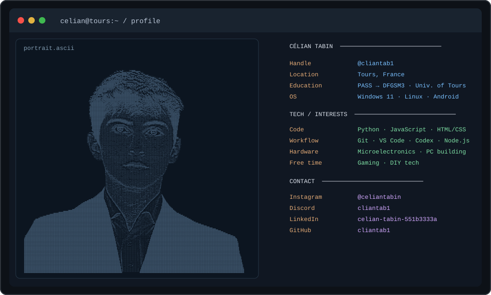

<!-- GitHub profile repository: cliantab1/cliantab1 -->

# Célian Tabin

**Medical student at Université de Tours · Technology enthusiast**

 

### About me

I began medical studies through **PASS** and am now in **DFGSM3 (third year)** at **Université de Tours, France**. I have a strong interest in **microelectronics, computer hardware and software development** and enjoy learning how systems work, from human physiology to circuits and code.

**Currently exploring:** Python, JavaScript, HTML/CSS, Git, VS Code, Node.js and Rust. I use Windows 11, Linux and Android.

### Find me

[Instagram](https://www.instagram.com/celiantabin/) · Discord: `cliantab1` · [LinkedIn](https://www.linkedin.com/in/celian-tabin-551b3333a/) · [GitHub](https://github.com/cliantab1)
